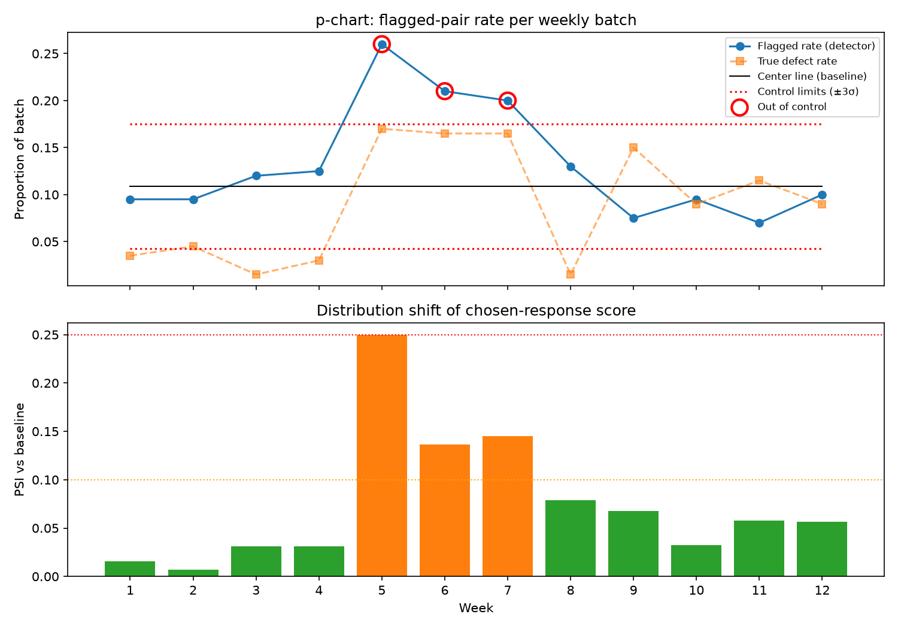

# RLHF Preference Data QA Pipeline

**Operationalizing data quality at scale.** An automated pipeline that scores
annotation quality in RLHF preference data (HH-RLHF), measures how well it catches
known-bad examples, and monitors quality drift across simulated annotation campaigns.

> Status: in progress. Results below are placeholders until the LLM-judge runs on real HH-RLHF data are complete.

## Why this exists

Preference data is only as good as its labels, and "good data" is usually a vibe.
This project turns it into measurable acceptance criteria ([`rubric.md`](rubric.md)),
then asks: *if we plant bad data on purpose, how much of it do we catch?*

## How it works

```
HH-RLHF ──► normalize ──► inject known defects ──► heuristics ──► LLM judge (A/B + B/A) ──► flags
                              (ground truth)        (free)        (cached, parallel)          │
                                                                                               ▼
                       drift monitoring ◄── weekly batches ◄── detection metrics (P/R/F1, CIs, bias)
                       (p-chart, PSI, KS)
```

1. **Load** (`load.py`): sample HH-RLHF and split each transcript into prompt, chosen, rejected.
2. **Inject** (`inject.py`): corrupt a known fraction of pairs with five defect types:
   `label_flip`, `low_effort`, `off_topic`, `truncated`, `duplicate`.
3. **Heuristics** (`heuristics.py`): cheap checks for length, generic filler, duplicates, and lexical relevance.
4. **LLM judge** (`judge.py`): scores both responses on helpfulness, relevance, effort and
   harmlessness, picks a winner, and is run **twice with the order swapped** to measure
   position bias. Outputs are validated JSON, cached in SQLite, and run in parallel.
5. **Evaluate** (`evaluate.py`): precision, recall and F1 per detector and per defect type,
   with Wilson 95% intervals, position-inconsistency rate, Cohen's kappa, batch acceptance.
6. **Drift** (`drift.py`): simulates 12 weekly campaigns (a sloppy annotator joins in
   week 5, guideline confusion in weeks 9–12) and tracks a p-chart, PSI and KS tests.

## Quickstart

```bash
git clone https://github.com/Uttaprexa/RLHF-Preference-Data-QA-Pipeline
cd RLHF-Preference-Data-QA-Pipeline
python -m venv .venv && source .venv/bin/activate
pip install -e ".[dev]"
pytest -q

# 1. Get data (real HH-RLHF, or --source synthetic to run offline)
qa-pipeline prepare --source hh --n 3000

# 2. Heuristics only (free)
qa-pipeline run --judge none

# 3. With the LLM judge (start small to check cost)
export ANTHROPIC_API_KEY=...
qa-pipeline run --judge anthropic --limit 300

# 4. Drift simulation
qa-pipeline drift --judge none
```

`--judge mock` runs an offline rule-based stand-in so you can test the plumbing
without an API key. Its numbers are **not** results.

Set `JUDGE_MODEL` to change the judge model. Every call is cached in
`results/cache.sqlite`, so reruns cost nothing.

## Results

*To fill in after real runs. Report HH-RLHF numbers only, never synthetic or mock.*

| Detector | Precision | Recall | F1 | FPR |
|---|---|---|---|---|
| Heuristics only | – | – | – | – |
| LLM judge only | – | – | – | – |
| Combined | – | – | – | – |

Recall by defect type (combined): label_flip –, low_effort –, off_topic –, truncated –, duplicate –

- Position inconsistency of the judge: –% of pairs
- Judge vs. my own labels on 100 pairs: Cohen's κ = –
- Drift: sloppy-annotator shift detected in week – (introduced week 5)
- Cost: $– per 1,000 pairs judged



## Project layout

```
src/qa_pipeline/
  load.py        HH-RLHF loading + synthetic demo data
  inject.py      defect injection with ground-truth labels
  heuristics.py  rule-based checks
  judge.py       LLM judge, prompt, JSON validation, cache, swap-order logic
  evaluate.py    detection metrics, confidence intervals, agreement
  drift.py       campaign simulation, p-chart, PSI, KS
  cli.py         command-line entry point
tests/           unit tests (offline)
rubric.md        acceptance criteria
```

## Roadmap

- [ ] Run LLM judge on 1–3k real HH-RLHF pairs and fill in results
- [ ] Hand-label 100 pairs and compute judge-vs-human kappa
- [ ] Second judge model and inter-judge agreement
- [ ] Harder defects: subtly worse responses, plausible but factually wrong answers
- [ ] Replace TF-IDF relevance with sentence embeddings
- [ ] Measure natural (non-injected) defect rate in HH-RLHF and inspect examples
- [ ] Streamlit dashboard
